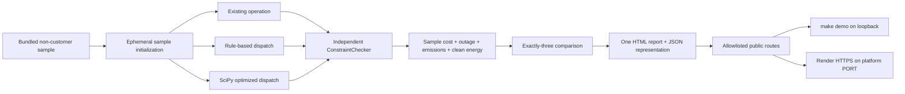
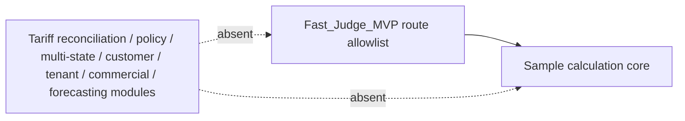
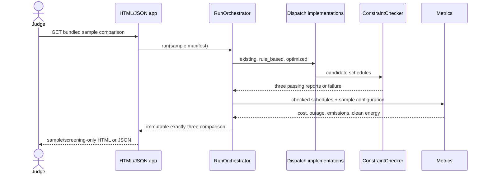
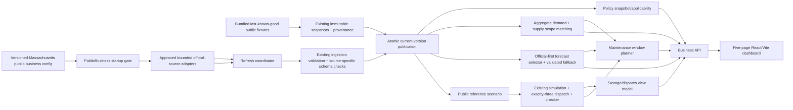

# OmniGridX Design Document

## Overview

The immediate target: the smallest credible Python demonstration of Massachusetts commercial-site solar-and-storage screening. It consumes one versioned, bundled, non-customer sample scenario; calculates exactly three alternatives (`existing`, `rule_based`, and `optimized`); independently checks every schedule; and presents sample-only cost, deterministic outage service, purchased-electricity emissions, and clean-energy metrics on one comparison/report page and minimal JSON endpoints.

The public demo is not a customer-data product. Every result is labeled `Screening_Estimate` and sample-only. The sample rate configuration is disclosed and is not represented as a verified tariff, historical reconciliation, account-applicability decision, or future-savings validation. Outage results are deterministic screening, not probabilistic reliability. The implementation performs constrained optimization, which may be described as grid intelligence; it contains no ML, weather, or demand forecasting and must not be described as AI forecasting.

Already implemented domain, ingestion, immutable-snapshot, Massachusetts reference metadata, and simulation work remains valid. The remaining critical path adds the independent checker, three dispatch alternatives, simple sample cost, outage/emissions/clean-energy metrics, orchestration/reporting, thin web delivery, deterministic local end-to-end coverage, Render `demo-public`, and submission artifacts.

### Fast path and deferred scope

| Fast_Judge_MVP runtime | Deferred and absent from public routes/runtime dependencies |
|---|---|
| Bundled sample selection and ephemeral initialization | Live or remote source adapters and uploads |
| Existing, rule-based, and SciPy-optimized schedules | Verified tariffs and historical bill reconciliation |
| Independent interval constraint checking | Policy intelligence and policy administration |
| Sample Screening_Estimate rate calculation | Multi-state activation/isolation beyond existing Massachusetts reference metadata |
| Cost, outage, emissions, and clean-energy metrics | Customer-data, authentication, tenant, private-pilot, production, retention, backup, and incident modules |
| One HTML comparison/report page and minimal JSON API | Commercial-validation evidence operations |
| Local deterministic end-to-end test and hosted smoke check | ML, weather, demand forecasting, and data-center modeling |

Deferred requirements remain valid post-MVP requirements. They do not block the judge build, are not exposed as placeholders, and cannot be reached through the public app.

### Design decisions and retained research

- Use the installed SciPy MILP adapter behind the existing `SolverPort`; publish an optimized schedule only after an independent checker passes. SciPy exposes the bounded mixed-integer optimization and status fields needed by the demo ([SciPy MILP documentation](https://docs.scipy.org/doc/scipy-1.14.1/reference/generated/scipy.optimize.milp.html)).
- Reuse the existing Python package, domain values, snapshots, sample pack metadata, and test stack. Add no database, queue, authentication, forecasting library, service, or abstraction for the judge path.
- Use Render’s free Python web service for the public URL, with Git deployment, managed HTTPS, platform `$PORT`, and ephemeral process storage. The service can sleep and cold-start, so local `make demo` remains the deterministic fallback ([Render free-tier guidance](https://render.com/articles/platforms-with-a-real-free-tier-for-developers-in-2026)).
- Keep Hypothesis available for optional broad properties, but make focused deterministic tests part of each required implementation leaf so the shortest required path is independently testable.

Content derived from linked documentation is rephrased for licensing compliance.

## Architecture

### Required runtime graph



The checker receives only frozen scenario inputs and candidate schedules. It recomputes conservation, decompositions, grid, asset, storage, reserve, service, direction, and terminal constraints rather than calling optimizer constraint builders. A failed check prevents publication of the entire comparison.

### Deferred boundary



The public process neither imports nor initializes deferred modules. It exposes no upload, arbitrary source registration, remote adapter, customer-data, commercial-validation mutation, authentication-administration, policy-administration, state-pack activation, tariff-reconciliation, or forecast route. Unknown and deferred routes return a stable unavailable response.

### Minimal execution sequence



The sample manifest and report serialization are deterministic. Local restart tests and hosted smoke checks compare a stable report fingerprint, excluding only explicitly nondeterministic transport metadata.

### Deployment modes

| Mode | Binding and state | Surface |
|---|---|---|
| `demo-local` | Loopback only; repository-bundled sample initialized into temporary/ephemeral local state | Same sample report and health behavior; `make demo` fallback |
| `demo-public` | Render platform host and `$PORT`; fresh ephemeral initialization on every boot | `/healthz`, one sample comparison/report flow, minimal JSON representation, and required static assets only |

`/healthz` reports ready only after bundled sample integrity, initialization, route allowlist, disabled-capability, and response-secret checks pass. Startup fails if a non-sample source, upload, remote adapter, customer route, commercial mutation, deferred module, worker, persistence claim, or response-visible secret is enabled. Restart discards runtime state and reconstructs the same sample report.

## Components and Interfaces

- **ExistingDispatch** and **RuleBasedDispatch:** produce the common `Schedule` schema from one frozen bundled scenario.
- **Optimizer / SolverPort:** build and solve the bounded cost-minimizing MILP and map solver outcomes. A candidate is not publishable until checked.
- **ConstraintChecker:** independently recomputes every hard constraint and returns interval-level residual diagnostics.
- **SampleCostCalculator:** applies one dated `Sample_Screening_Rate_Configuration` to gross imports and exports. It emits only `Screening_Estimate` values and required disclaimers.
- **OutageMetrics:** summarizes critical unserved kWh and interruption duration for the declared deterministic sample outage.
- **EmissionsMetrics:** uses gross nonnegative imports and the bundled factor; exports do not offset purchased-electricity emissions.
- **CleanEnergyMetrics:** calculates origin-aware clean-energy share and handles zero served load as not applicable.
- **RunOrchestrator:** runs exactly three alternatives against one manifest, requires three passing checker reports, calculates metrics, and publishes all-or-nothing.
- **ReportPresenter:** creates one human-readable comparison page and the corresponding stable JSON document without recomputing values.
- **DemoApplication:** owns `demo-local`/`demo-public` startup checks, the explicit route allowlist, `$PORT` binding, sample initialization, and `/healthz` readiness.
- **HostedSmokeValidator:** performs bounded HTTPS-only checks of health, fingerprint, and representative denied routes without transmitting source code, secrets, customer data, or arbitrary payloads.

```python
class ConstraintChecker(Protocol):
    def check(self, scenario: ScenarioVersion, schedule: Schedule) -> ConstraintReport: ...

class DispatchStrategy(Protocol):
    def run(self, scenario: ScenarioVersion) -> Schedule | DispatchFailure: ...

class SampleCostCalculator(Protocol):
    def calculate(
        self,
        intervals: Sequence[IntervalResult],
        config: SampleScreeningRateConfiguration,
    ) -> ScreeningCost: ...

class MetricsCalculator(Protocol):
    def calculate(self, scenario: ScenarioVersion, schedule: Schedule) -> AlternativeMetrics: ...
```

No new repository interface is required for the public demo. Existing immutable sample/snapshot structures may back initialization; process-local ephemeral state is sufficient.

### Minimal endpoints

| Method/path | Behavior |
|---|---|
| `GET /healthz` | Returns ready only after sample initialization and startup safety checks pass. |
| `GET /` | Renders the one bundled-sample comparison/report page. |
| `GET /api/sample-report` | Returns the same exactly-three report as stable JSON. |
| `POST /api/sample-run` | Optionally recomputes the same bundled scenario; accepts no body-supplied data. |
| Any other path | Returns the stable unavailable/not-found response without exposing deferred operations. |

The implementation may omit `POST /api/sample-run` when `GET /api/sample-report` performs the deterministic calculation or reads an initialized result. Fewer routes are preferred.

## Data Models

Existing immutable quantities, intervals, scenarios, schedules, manifests, and source/snapshot records remain unchanged. The Fast_Judge_MVP adds only the smallest report-facing values needed by the required path.

```text
SampleScreeningRateConfiguration {
  id, version, effective_period,
  import_rate_per_kwh, export_credit_per_kwh,
  currency, source_or_assumption_label, exclusions
}

ConstraintReport {
  passed,
  violations[]: {interval_id, constraint, residual, tolerance}
}

AlternativeMetrics {
  alternative: existing|rule_based|optimized,
  operating_cost_screening_estimate,
  peak_import_kw,
  critical_unserved_kwh,
  interruption_duration_hours,
  purchased_electricity_emissions,
  clean_energy_share|null,
  checker_passed,
  solver_status|null
}

FastJudgeReport {
  sample_id, manifest_fingerprint,
  alternatives[3],
  rate_configuration,
  assumptions, exclusions, labels, disclaimers,
  report_fingerprint
}
```

Invariants:

- `alternatives` contains each required alternative exactly once and no other strategy.
- Every published alternative has `checker_passed = true`.
- Every cost value is labeled `Screening_Estimate` and references the sample rate configuration.
- The report states sample-only, deterministic outage screening, no verified tariff, no customer data, no feeder/interconnection conclusion, and no AI forecasting.
- Ephemeral restart recreates an equivalent report and stable fingerprint from bundled bytes and versioned configuration.

## Public Business Mode Extension

This approved post-MVP extension refines the earlier deferred-boundary descriptions without changing Fast_Judge_MVP behavior or completion history. In this section, **judge mode** means the existing `demo-local` and `demo-public` ASGI application and **business mode** means a separate `public-business` ASGI application. The applications share domain and calculation modules but not route composition, startup configuration, refresh scheduling, or mutable runtime state.

### Extension decisions and repository research

- Keep the existing Python modular monolith, Starlette, React 19/Vite, SciPy `SolverPort`, SQLite provenance repository, and content-addressed snapshots. Add no microservice, router, charting, forecasting, HTTP-client, database, queue, or authentication dependency.
- Retain `omnigridx.web.app:app` as the judge entry point. Add a separate business entry point so importing or starting judge mode does not import business adapters, refresh, policy, or forecast modules.
- Use a small standard-library bounded HTTPS fetcher behind an injected transport. Exact hosts, paths, content types, byte limits, connection/read timeouts, and retry counts come from versioned Massachusetts pack adapter definitions; redirects and request-supplied URLs are rejected.
- Treat the approved official sources in Requirements 15–20 as adapter-specific contracts. Initial adapters cover only the source fixtures needed by the five pages, with canonical links to [ISO-NE load and demand reports](https://www.iso-ne.com/isoexpress/web/reports/load-and-demand), [Massachusetts energy data](https://www.mass.gov/massachusetts-energy-data), and official [Massachusetts policy sources](https://www.mass.gov/info-details/massachusetts-electric-rates-and-tariffs). Tests use checked-in representative source fixtures and never require live network access.
- Prefer a current Official_Published_Demand_Forecast. The only generated fallback is a declared time-of-week arithmetic-mean baseline evaluated against last-value persistence using rolling, time-ordered holdouts. A horizon is validated only when it has the configured minimum observations, finite error, and mean absolute error no worse than persistence. Otherwise forecast status is unavailable.
- Omit prediction intervals from the first business increment. The API states `prediction_intervals: not_produced`; no unsupported coverage claim is made.
- Reuse the existing optimized dispatch and independent checker for maintenance planning. Evaluate a bounded set of configured contiguous unavailability windows, optimize dispatch for each candidate, reject candidates that fail hard constraints or checking, then choose the lowest declared objective with earliest-start deterministic tie-breaking. This is optimization-based planning, not asset-health or failure prediction.

Content derived from linked source documentation is limited to source identity and is rephrased for licensing compliance.

### Public-business architecture



Refresh runs in the single Starlette business process as one bounded scheduled task. A refresh obtains bytes, stores the unchanged content-addressed snapshot, validates and normalizes a candidate Dataset version, and changes the current-version pointer in one SQLite transaction only after every required check passes. Retrieval or validation failure records a failed Refresh_Run and leaves prior bytes, versions, normalized rows, and current pointer unchanged. The latest valid version may remain stored but a stale section fails closed and displays its last-valid date, threshold, and latest refresh outcome.

The bundled fixture set is both deterministic test input and startup last-known-good data. Fixture provenance identifies the canonical official source and retrieval/as-of date; a fixture that is stale for a configured current use produces an unavailable page section rather than silently becoming current. Live refresh is never exercised by unit or integration tests.

### Deployment and security boundary

| Concern | Judge app (`omnigridx.web.app:app`) | Business app (`omnigridx.web.business_app:app`) |
|---|---|---|
| Inputs | Existing bundled judge sample only | Approved public fixtures, configured official adapters, and derived public-data results only |
| Routes | Existing `/`, `/healthz`, `/api/sample-report`, `/api/sample-run`, and assets unchanged | `/business/...`, `/api/business/...`, business assets, and business health only |
| Network | Remote adapters and scheduler disabled | Exact allowlisted HTTPS adapters with bounded scheduled refresh |
| Calculations | Existing deterministic exactly-three judge report | Shared calculation core called with a pinned public reference Scenario; presentation never recomputes metrics |
| State | Existing ephemeral judge initialization | Existing immutable snapshot/SQLite repositories plus atomic current-version pointers |
| Explicitly absent | Business routes/imports, policy, refresh, forecasts | Uploads, arbitrary URLs/sources, customer data, verified customer tariffs, authentication/tenancy, commercial mutation, feeder/interconnection conclusions, telemetry, and predictive maintenance |

`public-business` startup validates every enabled adapter definition, Dataset schema/version, freshness threshold, schedule, repository path, and route allowlist before readiness. Adapter calls are unavailable in judge modes. Business requests cannot choose a URL, host, adapter, Dataset version, or source body; requests can select only bounded identifiers already present in published public configuration. The first business increment supports public read access and scheduled refresh only, so no unauthenticated operator mutation endpoint is added.

### Business components and interfaces

- **PublicBusinessGate:** validates mode-specific settings and rejects upload, arbitrary-source, customer, private-tenant, tariff-verification, predictive-maintenance, non-allowlisted adapter, and judge-route crossover configurations.
- **OfficialSourceAdapter:** parses one documented official source schema into candidate public records. Adapter definitions and parsers are explicit per source; no generic arbitrary-URL adapter exists.
- **BoundedHttpsFetcher:** performs exact-host HTTPS GET requests with redirect rejection, content-type and byte limits, separate configured timeouts, bounded retries, and sanitized errors. Tests inject fixture bytes instead.
- **RefreshCoordinator:** records Refresh_Run metadata and atomically publishes valid immutable Dataset versions through existing snapshot/provenance repositories.
- **PublicDatasetCatalog:** resolves the current valid pinned version, freshness, and complete display metadata for a configured use.
- **PolicyService:** validates reviewed official Policy_Records, creates immutable Policy_Snapshots, computes freshness, and returns one applicability status from approved public evidence. Policy text and values are copied from reviewed records, never generated or paraphrased by a language model.
- **AggregateService:** returns historical demand and Supply_Context series, enforces Aggregate_Scope matching, and omits numeric comparisons with complete mismatch diagnostics when geography, interval, period, or basis differs.
- **ForecastService:** selects a current matching Official_Published_Demand_Forecast first; otherwise evaluates and returns the deterministic validated baseline or unavailable status. Over-horizon requests return a separately labeled Long_Range_Scenario_Projection only when configured assumptions exist.
- **BusinessStorageService:** maps an existing independently checked exactly-three report into business storage/SOC/dispatch fields and arithmetic peak differences. It withholds rejected schedules and does not call cost, metric, simulation, or dispatch calculations from presentation code.
- **MaintenancePlanner:** validates and pins all inputs, evaluates bounded contiguous candidate windows with the existing Simulation_Engine, Optimizer, and ConstraintChecker, and returns one checked minimum-objective plan or no plan with conflicts.
- **BusinessViewService:** assembles page/API view models with `current`, `stale`, `unavailable`, or `unsupported` section states, provenance, disclosures, and stable fingerprints.
- **BusinessApplication:** composes only the public-business services and routes. A scheduler invokes RefreshCoordinator directly; there is no public refresh mutation route.

```python
class OfficialSourceAdapter(Protocol):
    definition: AdapterDefinition
    def parse(self, raw: RawSnapshot, source: SourceRecord) -> CandidateDataset: ...

class RefreshCoordinator(Protocol):
    def refresh(self, adapter_id: str, scheduled_at: datetime) -> RefreshRun: ...

class ForecastService(Protocol):
    def select(self, scope: AggregateScope, issue_time: datetime, horizon: int) -> ForecastResult: ...

class MaintenancePlanner(Protocol):
    def plan(self, request: MaintenanceRequest) -> MaintenancePlanResult: ...
```

### Public-business routes and schemas

The five page paths are server fallbacks to the same built React entry point; ordinary links work without client-side router dependencies. The React shell derives the current page from the pathname and uses the History API only for optional same-origin enhancement.

| Method/path | Response |
|---|---|
| `GET /business` | Overview page shell. |
| `GET /business/demand-supply` | Historical demand, forecast, Supply_Context, and scope comparison page shell. |
| `GET /business/storage-dispatch` | Checked storage/SOC/exactly-three dispatch page shell. |
| `GET /business/policy` | Reviewed pinned policy page shell. |
| `GET /business/maintenance` | Configured optimization-based maintenance-plan page shell. |
| `GET /api/business/overview` | Dataset/status summary and public-context limitations. |
| `GET /api/business/demand-supply?scope_id=<configured>&horizon=<bounded-integer>` | Aggregate series, selected forecast/projection status, supply series, matching result, and metadata. |
| `GET /api/business/storage-dispatch?scenario_id=<configured>` | Existing checked report projection, storage/SOC fields, peaks, constraints, and disclosures. |
| `GET /api/business/policy?snapshot_id=<configured-or-current>` | Pinned reviewed records, freshness, supersession, applicability, and legal disclaimer. |
| `GET /api/business/maintenance?plan_id=<configured>` | Existing or deterministically computed plan for an allowlisted public planning configuration. |
| `GET /api/business/data-status` | Dataset versions, freshness, and latest Refresh_Run outcomes. |
| `GET /healthz` on the business app | Ready only after gate validation, repository initialization, fixture verification, and required view assembly. |
| Any other business method/path or any prohibited query/body | Stable rejection without invoking fetch or storage. |

Every API response uses this envelope:

```text
BusinessResponse {
  schema_version,
  generated_at,
  mode: "public-business",
  page,
  status: current|stale|unavailable|unsupported,
  sections[],
  sources[]: DatasetDisplayMetadata,
  limitations[],
  fingerprint,
  errors[]: {code, dataset_id|null, field|null, message}
}
```

Errors are sanitized and deterministic for the same inputs. `generated_at` is excluded from the fingerprint. Query identifiers are exact configured IDs; unknown IDs, repeated parameters, malformed or out-of-range horizons, bodies, and non-GET methods return `400`, `404`, or `405` without fallback.

### Public-business data models

```text
AdapterDefinition {
  id, canonical_scheme="https", canonical_host, canonical_path,
  media_types, max_response_bytes, connect_timeout_seconds,
  read_timeout_seconds, retry_limit, dataset_schema_version,
  freshness_threshold, refresh_schedule
}

RefreshRun {
  id, adapter_id, scheduled_at, started_at, completed_at,
  outcome, content_hash|null, validation_result,
  candidate_dataset_version|null, published_dataset_version|null,
  diagnostics[]
}

DatasetDisplayMetadata {
  dataset_id, publisher, canonical_url, version_or_as_of,
  retrieved_at, geography, units, interval_or_cadence,
  freshness_status, freshness_threshold
}

PolicyRecord {
  id, issuer, title, canonical_url, publication_date, effective_period,
  retrieved_at, last_reviewed_at, jurisdiction, customer_applicability,
  asset_applicability, supersession, successor_url|null,
  reviewer, review_status, use
}

PolicySnapshot {name, version, snapshot_date, record_ids[], content_hash}

AggregateScope {geography, interval, period_start, period_end, measurement_basis}
AggregateSeries {kind, scope, dataset_version, points[], metadata}
ForecastEvaluation {
  method, issue_time, maximum_validated_horizon, training_period,
  holdout_period, comparator, errors_by_horizon,
  prediction_intervals="not_produced", input_dataset_versions
}

BusinessStorageView {
  scenario_version, storage_configuration, alternatives[3],
  peak_differences, active_constraints, checker_status,
  labels, assumptions, exclusions
}

MaintenanceRequest {
  id, asset_id, horizon, allowed_start_intervals[], duration_intervals,
  asset_availability, operating_constraints, demand_forecast_version,
  supply_context_version, objective_components, checker_tolerance
}
MaintenancePlanResult {
  status, selected_start|null, selected_end|null, duration,
  asset_id, objective_value|null, objective_components,
  peak_impact|null, unserved_load_impact|null, binding_constraints[],
  input_versions, solver_status, checker_status, diagnostics[]
}
```

Additional invariants:

- A current pointer references one fully validated immutable Dataset version; failed candidates never become current.
- Every displayed value traces to a Source_Record and immutable snapshot or to a derived result that pins all input versions.
- Numeric demand/supply comparison exists if and only if all Aggregate_Scope dimensions match.
- Forecast selection prefers a current matching official publication over every generated fallback.
- Every displayed storage/dispatch metric is equal to the checked core report value or a disclosed arithmetic difference from those values.
- Every returned maintenance window is contiguous, uses pinned inputs, passes independent checking, and is optimal among feasible configured candidates under the declared objective and deterministic tie-break.
- `public-business` cannot retrieve request-supplied URLs or accept customer/telemetry data, and judge apps cannot initialize business services.

### Accessibility and presentation

The React shell provides a skip link, landmark elements, a visible page heading, five ordinary navigation links on every page, `aria-current="page"` on exactly one link, visible `:focus-visible` styling, accessible names for controls, keyboard-operable disclosure sections, status text independent of color, and `aria-live` only for asynchronous status changes. Each SVG trend graphic has a concise accessible name and is followed by a table containing the same timestamps, values, units, series identity, and status. Reduced-motion settings remain honored. Unavailable and unsupported states retain page navigation and explain the blocking Dataset or unsupported capability in text.

## Correctness Properties

*A property is a characteristic or behavior that should hold true across all valid executions of a system—essentially, a formal statement about what the system should do. Properties serve as the bridge between human-readable specifications and machine-verifiable correctness guarantees.*

The reflection step keeps the previously implemented ingestion/reproducibility properties, consolidates overlapping schedule checks, and leaves post-MVP properties explicitly deferred. Focused deterministic tests in required task leaves are the judge release gate; broader property tests remain useful but optional for the fast path.

### Property 1: Complete, conserved, independently valid schedules

For all valid scenarios and every published alternative, the schedule contains exactly one complete result per interval and every interval satisfies energy conservation, decompositions, grid/asset/storage/reserve/service bounds, with no independent-checker violation outside recorded tolerance.

**Validates: Requirements 2.1, 2.2, 2.3, 2.4, 2.5, 2.9, 2.10, 3.1, 3.3**

### Property 2: Storage state transition and bounds

For all valid battery specifications and checked schedules, state of charge follows the efficiency-adjusted transition from the declared initial value, remains inside capacity and active-reserve bounds, respects duration-adjusted power limits, reports conversion loss, and satisfies terminal treatment.

**Validates: Requirements 3.4, 3.5, 3.6, 3.7**

### Property 3: Unsupported simultaneous flows never occur

For all scenarios that do not permit simultaneous flow directions, every published interval has at most one positive grid-flow direction and at most one positive storage-flow direction.

**Validates: Requirements 2.6, 2.7**

### Property 4: Optimization objective reconciles to disclosed components

For all feasible optimized schedules, the reported objective equals sample Operating_Cost plus disclosed degradation, unserved-energy penalties, and terminal-energy term in one currency.

**Validates: Requirements 3.1, 3.2, 3.6, 3.8**

### Property 5: Historical tariff reconciliation is line-item strict

For all held-out billing sets after the Post_MVP_Capability is implemented, reconciliation succeeds if and only if every supported line item and total satisfies configured tolerance.

**Validates: Requirements 5.6, 5.7, 5.8, 5.9, 5.10**

### Property 6: Verified tariff effective dates and future labels are preserved

For all verified post-MVP tariff periods, each interval uses only the effective version and future costs remain Screening_Estimates.

**Validates: Requirements 5.11, 5.12, 5.13, 5.14**

### Property 7: Purchased-electricity emissions use gross imports only

For all interval sequences and applicable factors, purchased-electricity emissions equal gross nonnegative imports multiplied by interval factors; changing exports or discharge while imports remain fixed cannot reduce the estimate.

**Validates: Requirements 8.1, 8.2, 8.7**

### Property 8: State-pack isolation and canonical invariants

For all post-MVP State_Data_Packs, activation succeeds only when every validation passes, values resolve only from the pinned active pack, and absent capabilities return unsupported without fallback.

**Validates: Requirements 10.3, 10.4, 10.5, 10.6, 10.7, 10.8, 10.9, 10.10, 10.11**

### Property 9: Deterministic run reproducibility

For all immutable run manifests executed with recorded versions, repeated execution produces the same normalized inputs, alternative set, labels, fingerprint, and non-solver outputs, with optimized values within recorded tolerances.

**Validates: Requirements 1.3, 4.1, 4.2, 10.6**

### Property 10: Source provenance is complete and authoritative

For all normalized records accepted for analysis, each record traces to unchanged bundled bytes and complete source metadata, and a discovery URL does not replace the publisher URL.

**Validates: Requirements 1.3, 1.7, 1.13**

### Property 11: Record validation partitions without corruption

For all ingested datasets, record validation accepts exactly valid records and diagnoses rejected records, while dataset failure preserves prior versions.

**Validates: Requirements 1.2, 1.4, 1.5, 1.6**

### Property 12: Three-alternative sample decisions are transparent

For all Fast_Judge_MVP runs, the report contains exactly existing, rule-based, and optimized alternatives derived from one sample manifest, and each alternative contains all required checked metrics and Screening_Estimate labels.

**Validates: Requirements 4.1, 4.2, 4.3, 4.4, 4.5, 4.6, 4.7, 4.8, 5.1, 5.2, 5.3, 11.1, 11.2**

### Property 13: Judge capabilities fail closed

For all public-demo configurations and requests, only bundled sample health/report behavior is available; deferred, non-sample, forecasting, upload, remote, customer, mutation, and unsupported routes are rejected without fallback or commercial claims.

**Validates: Requirements 1.14, 1.15, 4.8, 4.9, 7.11, 11.1, 11.2, 11.3, 11.4, 13.1, 13.12, 13.13**

### Property 14: Production security gates real data

For all post-MVP real-data configurations, customer-data, private, and production operations remain unavailable until every applicable security control passes.

**Validates: Requirements 13.2, 13.3, 13.4, 13.5, 13.6, 13.7, 13.8, 13.9, 13.10, 13.11**

### Property 15: Commercial claims derive only from evidence

For all post-MVP evidence sets, paid-validation and repeat-demand claims follow only from the required qualifying evidence and partial evidence preserves applicable unvalidated clauses.

**Validates: Requirements 12.2, 12.3, 12.4, 12.5, 12.6, 12.7, 12.8**

### Property 16: Forecast evaluation prevents future leakage when enabled

For all future forecast evaluations, every explanatory input is available by simulated issue time, evaluation is time ordered, baseline comparisons use identical observations, and over-horizon requests are projections rather than forecasts.

**Validates: Requirements 7.1, 7.2, 7.3, 7.4, 7.5**

### Property 17: Dashboard route navigation is complete

For all five Public_Data_Business_Dashboard page routes, the rendered navigation contains all five page destinations and identifies exactly the current route.

**Validates: Requirements 15.1, 15.2**

### Property 18: Graphical and textual values are equivalent

For all dashboard view models containing a graph, status, or comparison, every material series identity, timestamp, value, unit, and status in the graphical model appears unchanged in the associated text or table model.

**Validates: Requirements 15.4, 17.1**

### Property 19: Policy publication is official, reviewed, pinned, and unambiguous

For all Policy_Records and Policy_Snapshots considered for publication, a record appears in current results if and only if the official-source, required-metadata, review, and freshness rules pass; each published record has exactly one applicability status, and reopening a historical result preserves its original snapshot pin.

**Validates: Requirements 16.1, 16.2, 16.3, 16.4, 16.6, 16.7, 16.8, 16.9, 16.11**

### Property 20: Forecast selection is official-first and leakage-safe

For all matching demand scopes, issue times, horizons, official forecast candidates, and historical public records, ForecastService selects a current Official_Published_Demand_Forecast when one exists; otherwise ForecastService returns only a fallback whose training and rolling holdout inputs were available by each simulated issue time and whose validated horizon meets the declared comparator rule, or returns unavailable. Requests beyond the selected maximum horizon are labeled Long_Range_Scenario_Projection with all configured assumptions.

**Validates: Requirements 17.2, 17.3, 17.4, 17.5, 17.6, 17.7, 17.11**

### Property 21: Aggregate comparison is scope-safe

For all historical demand and Supply_Context pairs, a numeric comparison is present if and only if geography, interval, time period, and measurement basis satisfy every declared Aggregate_Scope matching rule; every failing dimension appears in mismatch diagnostics.

**Validates: Requirements 17.8, 17.9, 17.10, 17.13**

### Property 22: Storage presentation preserves checked results

For all independently checked exactly-three core reports, BusinessStorageService presents each required alternative exactly once, preserves every storage, State_of_Charge, dispatch, constraint, metric, label, assumption, exclusion, and checker value, and computes each peak difference by direct subtraction from existing operation. For every rejected schedule, BusinessStorageService omits schedule metrics and reports only sanitized checker diagnostics.

**Validates: Requirements 18.1, 18.2, 18.3, 18.4, 18.5, 18.6, 18.7**

### Property 23: Maintenance plans are pinned, feasible, and optimal among candidates

For all valid MaintenanceRequest values and pinned input versions, every returned Maintenance_Window_Plan selects exactly one allowed contiguous window of the declared duration, uses the initially pinned demand and Supply_Context versions for every candidate, satisfies every declared hard constraint and independent check, and has no greater declared objective than any other feasible configured candidate; equal objectives select the earliest start. If no candidate passes, no window is returned and every common blocking constraint is identified.

**Validates: Requirements 19.1, 19.2, 19.3, 19.4, 19.5, 19.6**

### Property 24: Public-data refresh publication is atomic and traceable

For all configured Approved_Remote_Adapters and Refresh_Runs, accepted bytes are stored unchanged by content hash with complete Source_Record links, and a candidate Dataset becomes current if and only if provenance, schema, unit, geography, interval, coverage, and freshness checks all pass. Retrieval, validation, or publication failure preserves the prior current version and records a complete failed outcome without partial records.

**Validates: Requirements 15.7, 15.8, 17.13, 20.2, 20.3, 20.4, 20.5, 20.6, 20.7**

### Property 25: Public-business admission and mode isolation fail closed

For all application modes, startup configurations, and requests, Public_Business_Mode activates only complete allowlisted official-source adapters and exposes only configured public-data reads and derived plans, while judge modes preserve their route responses, bundled inputs, labels, fingerprints, denied operations, and absence of business runtime services. Uploads, arbitrary URLs or sources, customer/tenant/tariff-verification operations, predictive-maintenance operations, and non-allowlisted adapters are rejected before any fetch or storage effect.

**Validates: Requirements 15.5, 15.6, 15.9, 20.1, 20.8, 20.9, 20.10, 20.11, 20.12**

## Error Handling

- Reject missing or invalid sample inputs before dispatch and return all independently detectable diagnostics.
- Return no partial published comparison when any alternative fails, optimization has no allowed candidate, or independent checking fails.
- Map solver outcomes to `optimal`, `feasible_at_timeout`, `timeout_without_solution`, `proven_infeasible`, `numerical_failure`, or `constraint_check_failed`; schedules/objectives appear only where the domain status permits.
- Treat missing factor, rate, outage, or required scenario data as a calculation error rather than inventing defaults.
- Return sanitized stable errors with correlation IDs; never include bundled raw rows, environment values, secrets, stack traces, or solver internals in public responses.
- Fail startup when sample integrity, ephemeral initialization, route allowlist, disabled-feature, bind/`$PORT`, or response-secret checks fail. `/healthz` remains unready until all startup checks pass.
- The hosted smoke validator uses HTTPS, bounded attempts, per-request timeouts, and a clear unavailable result. It sends no repository content or customer payload.
- Business adapter failures expose a stable source-specific code, Dataset ID, and sanitized reason; responses never include response bytes, local paths, stack traces, environment values, or transport internals.
- Invalid, missing, mismatched-scope, or stale business inputs make only the affected section unavailable unless a required startup Dataset is affected; no fallback crosses Dataset, scope, state-pack, or deployment-mode boundaries.
- Refresh publication is transactional. Snapshot, parsing, validation, normalization, or pointer-update failure records the failed Refresh_Run and leaves the prior current version untouched.
- Policy records missing official provenance or review are excluded from current results. Missing applicability evidence yields `unknown` or `not-evaluated`, not inferred applicability.
- Forecast selection returns unavailable when neither a current matching official forecast nor a validated fallback exists. Over-horizon results are projections only when every declared assumption is configured.
- Maintenance validation reports all blocking inputs. Infeasible candidates retain sanitized constraint diagnostics; no plan is returned when every candidate fails.
- Business API parsing rejects unknown/repeated identifiers, malformed horizons, bodies, non-GET methods, and prohibited routes before invoking adapters, repositories, or calculation services.

## Requirement Traceability

| Required judge area | Requirements | Components/tasks |
|---|---|---|
| Completed foundations | R1, R10.1–10.2 | Existing values, manifests, snapshots, ingestion, Massachusetts metadata, Simulation_Engine; tasks 1.1–5.1 |
| Independent physical checking | R2, R3.3–3.7 | ConstraintChecker; task 5.2 |
| Exactly three alternatives and optimization | R3, R4 | dispatch strategies, SolverPort, status mapping; tasks 6.1–6.3 |
| Sample-only cost | R5.1–5.3 | SampleCostCalculator; task 7.1 |
| Outage, emissions, clean energy | R6, R8, R4.3–4.5 | metrics calculators; tasks 8.1–8.2 |
| Comparison and claims | R4, R11 | orchestrator and presenter; tasks 9.1–9.2 |
| Local/public delivery | R13.1, R13.12–13.13, R14 | minimal API/UI, Render startup, tests, smoke validator, submission package; tasks 14.1–16.1 |
| Deferred capabilities | R5.4–5.14, R7, R9, R10.3–10.11, R12, R13.2–13.11 | optional tasks 7.2–7.4, 10–13, and 17 |
| Public-business shell and isolation | R15, R20.8–20.12 | PublicBusinessGate, separate business ASGI app, React shell; tasks 18, 24, 25 |
| Approved-source refresh and freshness | R15.5–15.8, R20.1–20.8 | adapters, bounded fetcher, RefreshCoordinator, catalog; tasks 18.1, 19 |
| Reviewed policy snapshots | R16 | PolicyService and policy page/API; tasks 20.1, 24.3 |
| Aggregate demand, supply, and forecast | R17 | AggregateService, ForecastService, demand/supply page/API; tasks 21, 24.3 |
| Checked storage presentation | R18 | BusinessStorageService and storage page/API; tasks 22.1, 24.3 |
| Maintenance-window optimization | R19 | MaintenancePlanner and maintenance page/API; tasks 23, 24.3 |

## Testing Strategy

### Required local-first checks

Each required implementation leaf adds a focused deterministic test for its own behavior. This avoids making a separate broad test task a prerequisite while keeping non-trivial logic checked.

1. **Checker:** one valid multi-interval schedule and table-driven violations for conservation, SOC transition, bounds, direction, reserve, service, and terminal treatment.
2. **Dispatch/optimizer:** fixed sample expectations, one tiny known optimum, and stubbed status cases including timeout, infeasible, numerical failure, and checker rejection.
3. **Cost:** direct `Decimal` oracle for import charge minus export credit plus exact `Screening_Estimate` metadata/disclaimer assertions.
4. **Metrics:** declared outage case, missing/not-evaluated cases, gross-import emissions oracle, export irrelevance, clean-energy numerator, and zero denominator.
5. **Orchestration/report:** exactly three alternatives, one manifest, all checker passes, complete metric fields, all-or-nothing failure, exact sample/no-tariff/no-forecast disclosures, and stable report fingerprint.
6. **Web/local end to end:** start the app in-process with temporary state, request health/HTML/JSON, assert denied representative routes, and verify one deterministic bundled run from input bytes through report.
7. **Render/local restart:** validate configuration and `$PORT`, boot twice with fresh temporary state, require health only after initialization, and compare report fingerprints across restarts.
8. **Hosted smoke validator:** mocked local tests cover success, cold-start retry, timeout, non-HTTPS URL, fingerprint mismatch, and unexpectedly open restricted routes. A real URL check runs only after external Render service creation.
9. **Submission validation:** pass/fail fixtures check required tracked artifacts, metadata, notices, commands, `.kiro` content, secret/customer-data exclusions, Render disclosures, and commit consistency.

The deterministic local end-to-end test must pass before deployment. `make check` remains the checkpoint gate; `make demo` starts only the loopback bundled-sample fallback and is not run as a long-lived automated validation command.

### Optional broad tests and deferred modules

Hypothesis property tests remain optional for Properties 1–8 and 12–16 and use at least 100 examples with `Feature: omnigridx, Property N: <title>` comments. They do not block the Fast_Judge_MVP. Historical reconciliation, policy intelligence, multi-state activation, customer/tenant/production security, commercial evidence, live adapters, and forecasting receive no public route or runtime import unless their optional tasks are later selected and their own tests pass.

### Public-business deterministic checks

Every nontrivial required implementation leaf includes a narrow focused test. Tests inject a fixed clock, in-memory or temporary repositories, deterministic solver settings, and checked-in official-source fixtures; no test requires DNS, live HTTP, credentials, or wall-clock scheduling.

1. **Contracts and gate:** validate all record fields, configured-ID parsing, mode matrices, route sets, and no business-module import from judge entry points.
2. **Adapters and refresh:** parse one representative valid fixture per enabled source plus malformed/schema-drift/oversize/content-type cases; use a fake bounded transport for timeout, retry, redirect, and host rejection; verify unchanged bytes, complete provenance, Refresh_Run fields, and transactional current-pointer behavior.
3. **Policy:** cover official/unofficial source admission, missing metadata, review and freshness boundaries, supersession, all four applicability statuses, historical pinning, and exact legal disclaimer/source links.
4. **Demand and supply:** cover equivalent graph/table view data, every Aggregate_Scope mismatch dimension, metadata envelopes, failed-version isolation, and aggregate limitations.
5. **Forecast:** use a small hand-calculable time series for official preference, time-of-week means, persistence comparator, rolling holdout errors, publication-time filtering, insufficient history, stale official data, and horizon-to-projection boundary.
6. **Storage:** use the existing checked report fixture and spy calculators to prove no presentation recomputation; assert exactly-three membership, SOC/storage fields, peak subtraction, constraint state, rejected-schedule withholding, and disclosure fidelity.
7. **Maintenance:** use bounded hand-enumerated windows with known best, tie, infeasible, stale, and version-swap cases; assert contiguous duration, pinned inputs, optimizer/checker invocation, objective components, and absence of predictive fields.
8. **API and UI:** exercise every business route and schema, malformed queries, unavailable/unsupported sections, source links, stable fingerprints, five-page navigation, current-page state, semantic/accessibility attributes, graph-table equivalence, responsive build, and reduced-motion/focus CSS. Pure frontend route and formatting helpers use Node's built-in test runner; Vite build remains the compilation check, so no browser-test dependency is added.
9. **Isolation regression:** boot judge local, judge public, and public business independently; assert disjoint route/service sets, zero fetch/storage effects for prohibited requests, unchanged judge JSON/HTML/fingerprint fixtures, and absent business imports in judge processes.
10. **End to end:** initialize fixture snapshots, publish current versions, assemble all five pages, run checked storage and maintenance calculations, request HTML/JSON, and compare stable response fingerprints in one local no-network integration test.

### Public-business property tests

Hypothesis remains the selected property library. Optional property tests implement Properties 17–25 as one test per property with at least 100 examples and comments in the format `Feature: omnigridx, Property N: <title>`. Focused deterministic tests are required and remain the release gate; optional property tests broaden combinations without replacing fixture-based adapter and route integration tests.

### Release assertions

- No response or submission claim may describe the judge MVP as AI forecasting or imply implemented ML, weather, or demand forecasting.
- No result may claim a verified tariff, historical reconciliation, account applicability, future savings, probabilistic reliability, feeder capacity, service-connection feasibility, or interconnection feasibility.
- Public tests must prove that uploads, arbitrary source registration, remote adapters, customer operations, commercial mutation, policy/state/tariff administration, and forecast routes are unavailable.
- Render hosting is an external availability concern. Local restart and smoke-validator tests are deterministic; creation of the Render service and recording its public HTTPS URL remain unavoidable operator steps.
- Public-business responses identify public planning context and never claim customer load, verified tariffs, future savings, probabilistic reliability, feeder/service/interconnection feasibility, legal advice, asset health, remaining useful life, or failure prediction.
- Judge builds and tests remain byte-for-byte behaviorally compatible at their existing routes; adding business mode cannot enable adapters, scheduler, policy, forecast, or business routes in either judge process.
- Public-business release requires all fixture-based checks, strict typing, frontend build, package build, and judge regression suite to pass. Live-source smoke checks are operator-only and cannot replace deterministic fixture tests.
